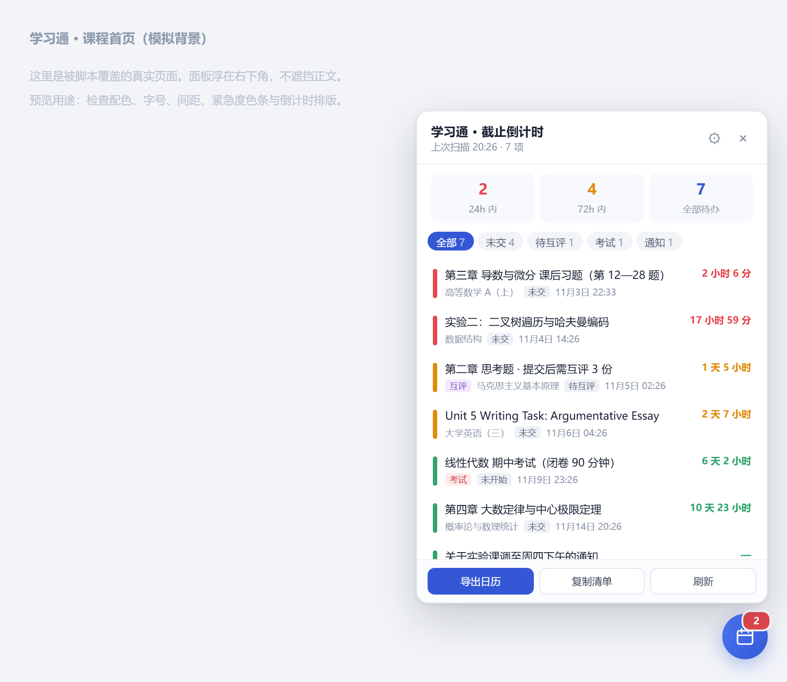

# 学习通作业倒计时 · 日历订阅

> 把学习通的作业截止时间，变成你手机日历里的**真实闹钟**。

一个 Tampermonkey 用户脚本。点一下，扫描你所有课程的未交作业、待互评、待批阅、考试和未读通知，按剩余时间排好序；再点一下，导出成 `.ics`，丢进手机系统日历——然后就再也不用记着去打开学习通了。



<sub>截图为真实脚本渲染（示例数据）。24 小时内标红、72 小时内标橙，右侧是实时倒计时。</sub>

---

## 为什么还要做这个？

学习通的作业聚合脚本不止一个，做得好的也有。但它们的共同形态是**又一个网页悬浮面板**——你必须先打开电脑、打开浏览器、打开学习通、点开面板，才能看见作业。

而作业真正被忘掉，从来不是因为「不好查」，是因为**它不在你每天真正会看的地方**。

这个项目不解决「查得更快」，它解决「根本不用查」：

| | 常规作业聚合脚本 | 本项目 |
|---|---|---|
| 查看方式 | 打开网页点面板 | 手机锁屏、通知栏、系统日历 |
| 会主动提醒你吗 | 不会，靠你自己想起来 | 会，提前 3 天 / 1 天 / 2 小时各响一次 |
| 需要打开浏览器吗 | 需要 | 不需要 |
| 需要服务器/账号密码吗 | 不需要 | 不需要 |
| 断网后还能看吗 | 不能 | 能，信息已经在日历里 |
| 数据流向 | 留在本地 | 留在本地，`.ics` 由你自己导入 |

日历订阅这条路还有一个隐性好处：**它不制造依赖**。导出的 `.ics` 是标准格式，苹果日历、Google Calendar、Outlook、小米/华为/OPPO 系统日历都能直接吃。哪天你不想用这个脚本了，日历里的日程照样在，不需要卸载什么。

---

## 安装

### 第 1 步：装篡改猴（Tampermonkey）

「篡改猴」是 Tampermonkey 的中文名，同一个东西。**Edge 用户**：

1. 打开 Edge，点右上角 `…` → **扩展** → 左下角 **获取 Microsoft Edge 扩展**
2. 搜索 `Tampermonkey`，认准开发者 **Jan Biniok**、橙色猴子图标（商店里有不少山寨的）
3. 点 **获取** → 确认添加

Chrome / Firefox 用户从各自商店装即可；商店打不开时，可到 [tampermonkey.net](https://www.tampermonkey.net/) 下载压缩包，在 `edge://extensions` 打开「开发人员模式」→「加载解压缩的扩展」。

### 第 2 步：打开「允许用户脚本」开关 ⚠️

**这一步不做，装完脚本也不会运行。**

新版 Chromium 内核（Chrome 138+ / 部分 Edge 版本）默认禁止扩展执行用户脚本，需要手动放行：

1. 地址栏输入 `edge://extensions`（Chrome 是 `chrome://extensions`）
2. 找到 Tampermonkey → 点 **详细信息**
3. 打开 **「允许用户脚本」/「Allow user scripts」** 开关
4. 如果找不到这个开关，就在扩展页面把 **「开发人员模式」** 打开，再回来看

### 第 3 步：装本脚本

**方式一（从 GitHub 一键安装，最省事）**

点这个链接，篡改猴会自动弹出安装页，点「安装」即可：

👉 **<https://github.com/hjlhjl6667/chaoxing-deadline/raw/main/chaoxing-deadline.user.js>**

**方式二（本地文件）**：把 `chaoxing-deadline.user.js` 从文件夹直接拖进 Edge 窗口，篡改猴会弹出安装页 → 点 **安装**。

**方式三（拖拽没反应时）**：
1. 点工具栏的猴子图标 → **管理面板** → 左上角 **`+`**（添加新脚本）
2. 删掉编辑器里的默认内容
3. 用记事本打开 `chaoxing-deadline.user.js`，全选复制（**必须包含开头那段 `// ==UserScript==` 注释**）
4. 粘贴进编辑器，按 `Ctrl+S` 保存

### 第 4 步：确认生效

打开 <https://i.chaoxing.com>（确认已登录）。右下角出现**蓝色圆形日历按钮**即成功。

没出现的话：点猴子图标，看列表里本脚本是否处于启用状态，以及当前页面是否在它的生效范围内。

## 使用

点右下角 📅 → 首次会提示「点击刷新开始扫描」→ 点 **刷新**。

它会依次：取课程列表 → 逐门课取作业（自动翻页）→ 取考试 → 取未读通知，然后按剩余时间排序展示。24 小时内标红，72 小时内标橙。

### 导出到手机日历（关键一步）

点 **导出日历**，会下载一个 `学习通截止提醒-YYYYMMDD.ics`。

**iPhone**
1. 把 `.ics` 用微信/AirDrop/邮件发到手机
2. 点开文件 → 「添加到日历」
3. 事件会自动落到默认日历里，三个闹钟随之生效

> 想让它们单独成一组、能一键全部删掉？先在「日历」App 里新建一个叫「学习通」的日历，导入时选择它。

**Android（小米/华为/OPPO/vivo 等）**
1. 把 `.ics` 存到手机
2. 用「日历」App 打开，或系统文件管理器点开选「日历」导入
3. 部分机型需在日历设置里允许「导入日程」

**电脑上想先看看效果，又不想动系统日历**：

用浏览器打开 [`examples/calendar-preview.html`](examples/calendar-preview.html)，它内置一个独立的 `.ics` 解析器，会把这个日历文件读出来，渲染成

- 左边：手机锁屏上截止临近时弹出来的通知（含实时倒计时）
- 右边：解析诊断 + 完整事件清单

```
node tools/gen-calendar-preview.mjs   # 改了 demo.ics 后重新生成
```

这个页面跟脚本本身没有任何关系，是纯前端的一个日历文件阅读器。**它能把数据正确读出来，就说明生成的 `.ics` 符合标准**，任何日历 App 都能吃。

页面还支持把你从脚本导出的真实 `.ics` 直接拖进去——抓取的数据对不对，一眼就能看出来，不用先导入手机再检查。

### 提醒策略

默认写三个闹钟：截止前 **3 天 / 1 天 / 2 小时**。可在 ⚙ 设置里改成 15 分钟、1 小时、2 小时、1 天、3 天的任意组合。

事件本身在日历里占 30 分钟（截止时刻起），方便在日视图里看见，不阻塞你的时间（`TRANSP:TRANSPARENT`）。

### 其他

- **复制清单**：把待办导出成 Markdown，适合贴进 Notion / Obsidian / 备忘录
- **设置**：可开关「包含考试」「包含待互评」「包含待批阅」「包含未读通知」「包含已过期」「跳过已结课」
- 扫描结果缓存 5 分钟，课程列表缓存 30 分钟，避免反复请求
- 倒计时每 30 秒自动刷新，不用手动重开面板

---

## 工作原理

学习通没有公开 API，全部走网页接口 + 你已有的登录态。链路如下（详见 [`docs/API.md`](docs/API.md)）：

```
GET  mooc1-api.chaoxing.com/mycourse/backclazzdata        → 全部课程（courseId / classId / cpi）
GET  mooc1.chaoxing.com/visit/stucoursemiddle             → 课程中间页，提取 workEnc 与 stuenc
GET  mooc1.chaoxing.com/mooc-ans/mooc2/work/list          → 作业列表 HTML（需 enc + t + stuenc）
GET  mooc1-api.chaoxing.com/exam-ans/exam/test/...        → 考试列表
POST notice.chaoxing.com/pc/notice/getNoticeList          → 未读通知
```

两个容易踩的点，本项目都处理了：

1. **`work/list` 只给 `enc` 会返回「无权限」**，必须同时带上 `t`（时间戳）和 `stuenc`。很多文档没写这条。
2. **列表页不给绝对截止时间**，只给「剩余90小时37分钟」这种相对描述。本项目的做法是「扫描时刻 + 剩余时长」反推绝对时间，误差在秒级，对分钟级提醒完全够用。设置里另有「精确模式」可开（会走作业详情页读绝对时间，但请求量翻倍，风控风险更高）。

---

## 风控与安全

需要说清楚：

- 本脚本通过自动化请求读取你的作业数据。**学习通可能对此触发风控**，表现为要求输入验证码或临时限制部分功能。介意的话请不要使用。
- 脚本**不收集、不上传任何数据**。没有后端，没有统计，没有远程配置。所有信息只存在于你的浏览器本地（`GM_setValue`）和导出的 `.ics` 文件里。
- 脚本**不接触你的密码**。它复用浏览器已有的 Cookie。
- 为降低风险：并发 3 路、同课程翻页间隔 500ms、已结课课程默认跳过、结果缓存 5 分钟。请勿在短时间内反复点「刷新」。

---

## 已知限制

- 只支持**学生**账号。
- 依赖平台的 HTML 结构，学习通改版会导致解析失效。脚本已做多套选择器兜底，但改版严重时仍需跟进更新。
- 「未读通知」模块是**实验性**的：通知接口的参数随平台调整，可能失效。失效时其他功能不受影响。
- 相对时间反推有秒级误差；跨天边界（比如「剩余 0 分钟」）可能落到前一分钟。
- 已结课判断基于 `isretire` 与 `endDate`，个别课程可能误判，可在设置里关掉「跳过已结课」。

---

## 开发

零依赖，纯原生 JS，单文件即可安装。

```bash
node test/ics.test.mjs      # 67 项逻辑断言（时间解析 / ICS 转义 / UTF-8 折行 / 日历结构）
node tools/gen-demo.mjs     # 重新生成 examples/demo.ics
node tools/gen-calendar-preview.mjs   # 重新生成可视化验证页
```

测试不是复制一份代码来测，而是把发布文件里标记为 `@testable` 的代码段抽出来在 `vm` 里跑——**测的就是发出去的**。

`window.__CXD__` 暴露了 `API` / `ICS` / `TimeParser` / `scanAll`，可在控制台里调试。

---

## 许可

[MIT](LICENSE)

本项目与超星学习通官方无关。
